:toc:

# Specman 1.4 Manual

## Introduction
// tag::readme[] - this region is copied into readme.adoc by the 'generate-readme' execution in pom.xml (mvn package, or standalone: mvn antrun:run@generate-readme)
Specman is a WYSIWYG editor for actogramms, which are similar to Nassi-Shneiderman diagrams but incorporate some graphical elements from UML activity diagrams. Specman is designed for the specification of procedural workflows in software systems, and grew out of more than 15 years of experience in software engineering based on standard tools like Microsoft Word, Confluence and UML.

Microsoft Word is an excellent word processor with change tracking (a crucial aspect for iterative / agile development), but control structures like loops and branches are difficult to visualize. UML activity diagrams, on the other hand, are very good at visualizing control structures, but change tracking and diagram layout stability in iterative development are poor. Specman combines features of these tools in a way that has proven particularly useful for efficient, iterative software development.

## Hello Specman
Specman is a small Java 2D / Swing application packaged as an executable JAR file using Maven. To run Specman, you need a Java Runtime Environment (JRE) version 21 or higher installed. The main class is specman.Specman, and the delivery package includes launcher scripts for Windows (`specman.bat`) and Linux (`specman.sh`) that check the Java installation and locate the jar before starting the application. Opening the file link:anagramms.nsd[anagramms.nsd] in Specman displays the following diagram:

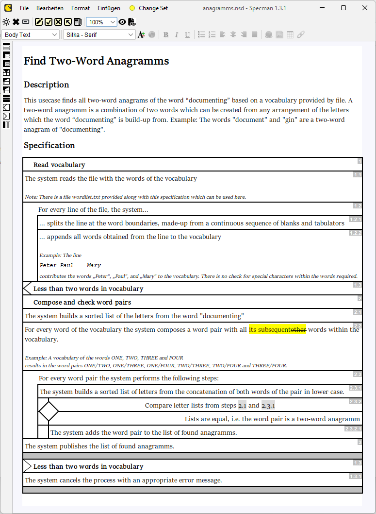

A significant graphical difference to Nassi-Shneiderman diagrams is the representation of decision nodes by diamonds as they are known from UML activity diagrams. The original Nassi-Shneiderman notation uses triangles which can make a diagram look cluttered when used repeatedly.

Every structured step in a diagram can be collapsed, to hide the details of its inner structure. The following screenshot shows what the "Two Word Anagrams" diagram looks like when all steps are collapsed:

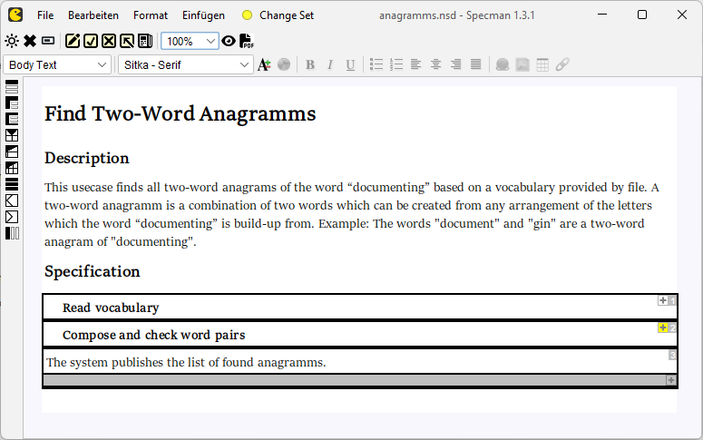

The requirement in the description of the example is taken from a link:https://codingdojo.org/kata/Anagram/[code kata] published on codingdojo.org which perfectly illustrates what Specman and actogramms are made for: up-front design - both structured and change-friendly - rather than "design a little, code a little", which is a widespread antipattern. Check out link:https://clean-code-developer.com/[clean-code-developer.com] to see why it's an antipattern. Writing code directly from the business requirements has a high risk of ending up in spaghetti code even though the task doesn't sound too complicated at first glance. No big problem in one-shot coding, but a nightmare in iterative development where requirements are constantly changing.

### AI-ready file format
Since version 1.3, the diagram files have a pseudocode-like format which makes them machine-readable e.g. to feed code generators or AI agent based programming pipelines. The file structure follows an EBNF grammar defined in SpecmanModel_V002.g4, which is part of the delivery. It is explicitly designed to also integrate AI support in the process of creating specifications. Using Specman's autoload mode and its headless sanitizer makes it possible to set up a collaborative environment where the user is working with the WYSIWYG UI while an AI agent is supporting in the background. Specifications are supposed to be designed as both human-readable and technically exact, using a natural but precise language according to basic clean code development principles and the central ideas of Domain-Driven Design. The result is a document with structure and textual content which is perfectly understandable for AI agents.

### PDF export
Specman provides a high-quality PDF export, so that the diagrams can be shared easily with everyone involved in the software engineering process. Reviewers only need a standard tool like Adobe's Acrobat Reader to open and comment on the exported diagrams. See link:anagramms-export.pdf[anagramms-export.pdf] for an example of a PDF export of the "Anagrams" diagram.

### Change tracking
The yellow highlighting in the screenshot above indicates changes which were made in change mode. Similar to Microsoft Word, e.g. deleting text in change mode does not actually remove the text; instead, it is displayed as struck through with a yellow background as if someone had marked the section with a text marker. Changes in a model are therefore immediately recognizable by everyone. This is a crucial aspect in iterative development where specifications evolve over time.

Folding up a structured step which includes any change marks will cause the unfold-button beside the step number to be displayed in the highlight color of the hidden changes. I.e. even if details are hidden, it is still visible that there are changes in the folded up section.

Since version 1.2.1, Specman supports multiple change sets, which is of interest e.g. if there are multiple change requests to be considered in parallel within a single development iteration.

### Real world use case specifications
To get an idea of what real-world specifications look like in Specman, see the link:usecase-birdsview.png[bird's view] on a mid-size system usecase specification from ongoing project development.
// end::readme[] - see tag::readme[] above

## Specman main window
Starting Specman brings up an empty window with the following areas.

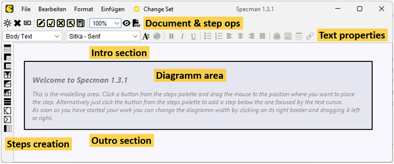

The diagram area is initially empty as well as the intro and outro sections above and below. These sections are important in real-world applications where they contain additional context information like preconditions, postconditions, actors, references to related documents etc. To get an idea of how this may look, see the link:usecase-birdsview.png[bird's view] on a mid-size system usecase specification from ongoing project development.

## Populating the diagram
You populate the diagram using the step creation toolbar at the left of the window. Pressing a button in the toolbar creates a new step of the corresponding type in the diagram area. The new step is created directly below the step containing the currently focused edit area. If the current focus is not within a step's edit area, the new step is created at the end of the diagram.

As an alternative, most steps can be created by drag and drop: press the corresponding button from the toolbar, hold the mouse button down, move the mouse to the desired position in the diagram, and release the button. A semi-transparent gray insertion bar indicates where the new step will be created when the mouse button is released.

The step creation toolbar provides the following buttons:

### image:../src/main/resources/images/einfacher-schritt.png[Simple Step] Simple step

Creates a simple step in the diagram. The new step is immediately focused, i.e. pressing the button multiple times creates multiple steps one after the other.

### image:../src/main/resources/images/subsequenz-schritt.png[Sub Sequence Step] Subsequence step

Creates a subsequence of steps with an initial simple step immediately added within. Subsequences are not part of original Nassi-Shneiderman diagrams. They bring structure into larger sequences like chapters in a book. These substructures may be directly used as a reasonable indicator for how to structure the code when implementing the specification.

The steps within the subsequence are numbered on a lower level, e.g. step 2.1, 2.2, 2.3 within subsequence step 2.

Subsequences can be folded up to hide their content when the details are currently not of interest. Moving the mouse just to the right of the subsequence's step number brings up a small button with a minus sign. Pressing this button folds up the subsequence. The button then shows a plus sign for unfolding the subsequence again.

### image:../src/main/resources/images/while-schritt.png[While Step] While step

Creates a loop step with an initial simple step in its repetition sequence immediately added. The repetition sequence must not be empty. So if the first step needs to be something other than a simple step, add a step of the required type and remove the initial first step afterward.

### image:../src/main/resources/images/whilewhile-schritt.png[While While Step] While-while step

Creates a loop step with an additional horizontal empty bar at the bottom. This is functionally identical with the loop step, but sometimes the extra bar makes the lower boundary of the loop easier to recognize. E.g. if there are catch steps at the end of the loop's repetition sequence.

### image:../src/main/resources/images/ifelse-schritt.png[If Else Step] If-else step

Creates an if-else step with an initial simple step in its if and else branches. The division ratio of the branches may be changed by clicking on the separating line between the branches and moving it right or left.

### image:../src/main/resources/images/if-schritt.png[If Step] If step

Creates an if step. Unlike the if-else step, the left branch is empty and its width cannot be modified.

### image:../src/main/resources/images/case-schritt.png[Case Step] Case step

Creates a case step with the default branch on the left and two other initial case branches on the right. Additional branches can be added by pressing the corresponding button from the steps creation toolbar (see below). Branch removal is achieved by placing the cursor in the branch's heading or condition edit area and pressing the delete button from the step & document properties toolbar. However, two case branches and the default branch are the minimum which a case step has to provide. Otherwise it's an if or if-else step.

### image:../src/main/resources/images/zweig.png[New Branch] New branch

Creates a new branch in a previously created case step. The creation by button click requires placing the cursor into an existing branch's heading edit area first. The new branch is then added _left_ from the cursor-selected branch. Alternatively the new branch can be created by drag & drop which requires dragging into an existing branch's heading. A vertical insertion bar indicates where the new branch will be created when releasing the mouse button.

### image:../src/main/resources/images/break-schritt.png[Break Step] Break step

Creates a break step which can be understood as the occurrence of a business exception. It causes the following steps to be skipped down to the place where the exception gets caught. If it is not caught anywhere the exception causes the complete usecase to be aborted which is described in the diagram. However, this is usually not a good idea as it makes the reader wonder if this was designed by intention or if the design is not yet complete.

There are two flavours for using break steps: The compact form is the one being used in the anagram example: The preceding step describes some system functionality and the break step simply mentions an exceptional situation which may occur in the step before. An appropriate check for the situation is implicitly assumed to be included in the described functionality. The more comprehensive form includes a preceding step which _explicitly_ consists of nothing else but the check for a particular exceptional situation where the break step(s) then expresses the abortion of the step sequence in case the situation is present. This form is recommended, if the situation takes some more text to be described or if it is of particular importance in the overall context. The actual system functionality is then described in a step following the break step(s).

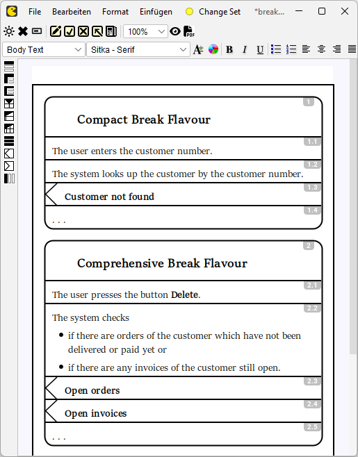

### image:../src/main/resources/images/catch-schritt.png[Catch Step] Catch step

Creates a catch step for a previously defined break step. Unlike all other steps, it is not just inserted at the drop position: the creation takes the following steps, no matter whether the button is pressed or dragged into the diagram.

* Place the cursor into any step of the sequence to which the catch step is to be added at the very end. When working with drag & drop, drop the button anywhere in this sequence instead.
* Press the catch step button from the steps creation toolbar. This brings up a dialog for break step selection. The dialog allows you to choose from all break steps
** which are not already coupled with a catch step yet and
** which are present in the step sequence to which the catch step is about to be attached, or in any of its nested sequences
* After break step selection, the coupled catch step is added, including a handling sequence with an initial simple step.
* The break step's content makes up the heading of the catch step, and the text content of both is now always kept in sync automatically.

If a development project is working with a programming language that supports exceptions, it is strongly recommended to represent break and catch by throwing and catching exceptions in the code. In this case, it is a good idea to use relatively short expressions in the break step text, from which exception type names can be directly derived.

Catch steps are displayed in visually separated sections with a gray bar above and below, making it clear that they are not part of the normal control flow. Multiple catch steps for the same sequence are placed side by side, each with its own handling sequence below its heading. New catch steps are appended on the right. Right-clicking the step number of a catch heading brings up a context menu with _Move left_ and _Move right_ to change the order, and the widths of the catch steps can be changed by dragging the dividers between them. As in loops, the handling sequence must not be empty, i.e. its last step cannot be deleted.

A single catch step can also handle several break steps, just like `catch (A | B e)` in Java. The additional break steps are called _co-catches_. To add one, place the cursor in the heading of the catch step and press the catch step button, or drop the button onto the heading. The dialog then adds the chosen break step as a co-catch of this catch step instead of creating a new one. The headings of co-catches are stacked below the main heading, and each heading is coupled with its own break step, whose text it shows. A co-catch can be moved up and down among the other co-catches by the context menu of its step number.

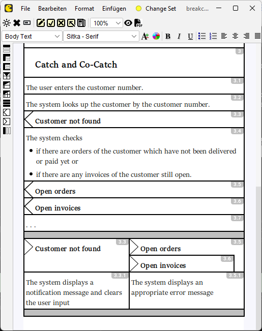

Pressing the Ctrl key while clicking the step number of a break step jumps to the heading of its catch step. The same works the other way round, from the catch heading to the break step.

Deleting works as follows, using _Delete_ from the step number's context menu:

* On the main heading of a catch step, it removes the entire catch step including its co-catches.
* On the heading of a co-catch, it removes just this co-catch.
* The break steps stay in both cases. They are no longer coupled with a catch step, so they show up again in the break step selection dialog.
* The other way round, deleting a break step removes its catch heading. If this was the main heading, the entire catch step is removed.

The catch area can be folded up like any other structured step. The button for this is on the right of the gray bar above the catch area. It shows up when you move the mouse there, and stays visible as long as the area is folded.

## Editing step content
The content of a step is not just a single text. It is a vertical sequence of _edit areas_, which can be text, list items, tables and images, in any order, with a text area always coming first. Everything is edited in place, like in a word processor.

### Text and formatting
Text formatting is based on an HTML subset. However, Specman is a WYSIWYG editor, so you never have to deal with HTML source code when using the UI. The toolbar and the menus work like in a word processor, and what they offer is what HTML offers: paragraphs with a paragraph style (body text, headings, block quotes, preformatted text), character styles, font, size, color and alignment. The text is saved as HTML in the diagram file, together with a plain text rendition for tools which don't want to deal with HTML like full text search in IDEs.

HTML is used for text formatting only. Lists, images and tables are not part of the text content, even though HTML could express them. In Specman they are independent building blocks of the step content, each being an edit area of its own, see <<_lists,Lists>>, <<_tables,Tables>> and <<_images,Images>>. This allows Specman to render them better than a plain HTML component could, and, above all, to track changes at a much finer granularity (see <<changetracking,Change Tracking>>). An added list item, a removed table row or a deleted image is marked individually instead of marking a whole text as changed.

Formatting is done with the formatting toolbar above the diagram and the menus _Edit_, _Format_ and _Insert_. The toolbar provides familiar options such as bold, italic, underline, font, size, color and alignment, plus the paragraph style box. The _Format_ menu has even more character styles, e.g. subscript and superscript. Strikethrough and text background colors are missing on purpose: they are reserved for the markings of change mode, see <<changetracking,Change Tracking>>.

Pasting with Ctrl+V depends on where the content comes from:

* Text copied within Specman keeps its formatting, including step references and tables.
* Text from other applications, like Word or a browser, is reduced to plain text. Formatting is dropped.
* A pure image in the clipboard, e.g. a screenshot, becomes an image at the caret. If the clipboard contains text as well, the text wins.

Complete steps are copied, cut and pasted using the step context menu rather than operating on text content, see <<steprearranging,Moving, copying and deleting steps>>.

### Lists
The toolbar buttons for unordered and ordered lists turn the paragraph at the caret into a list item. Text before and after it stays what it was. Pressing Enter splits the item at the caret. Pressing Backspace at the start of an item dissolves it back into plain text, which is also the way out of a list: Enter in an empty item just creates the next empty item. Pressing one of the list buttons within an item dissolves it as well.

A list item can contain more than text, e.g. images and tables. Lists cannot be nested yet.

### Tables
The table button of the formatting toolbar allows to add a table at the caret position of a text. Cells can contain the same things as a step, i.e. texts, lists, images, and tables. There is no header row and no formatting of the table itself.

The structure of a table is edited with the mouse in the thin margin around it:

* Above the table, the gap between two columns adds a column, and a column itself is removed. Left of the table, the same applies to rows.
* The top left corner allows to remove, copy or cut the entire table.

Hovering over such a spot highlights it and changes the mouse cursor, and a click executes the action. While the mouse is over the top left corner, Ctrl+C, Ctrl+X and Delete copy, cut and delete the table.

In a cell, Tab moves to the next cell, and Tab in the very last cell appends a row. Column widths are changed by dragging the dividers between the columns. The divider at the right edge of the table changes the width of the entire table. Pressing Esc while dragging cancels the change.

### Images
The image button of the formatting toolbar opens a file chooser for JPG, PNG, GIF and BMP files. Alternatively, an image can be pasted from the clipboard (see above). The image is embedded in the diagram file as a PNG, so the original file is no longer needed.

Clicking an image selects it. Delete or Backspace removes it, and Ctrl+C or Ctrl+X copies or cuts it. To continue typing below the image, press Enter. Dragging the narrow bar at the right edge of the image changes its size. An image is never wider than the diagram, and its size follows the zoom factor.

### Step references
Step references are links to other steps within the text, like "see step 2.3". They are inserted with the step reference button of the formatting toolbar, or by _Insert_ > _Link to Stepnumber..._. The dialog lists all steps by number and the beginning of their text. A filter field narrows the list, and a click on an entry inserts the reference at the caret.

A step reference is displayed as the step number on a light gray background. It behaves like a single character: you cannot type into it, the cursor jumps over it, and Backspace removes it entirely. If it needs to point somewhere else, remove it and insert a new one.

The reference number follows its step automatically when the numbering changes. If the step is deleted, the reference remains with a question mark behind the number, e.g. _2.3?_. Deleting a referenced step causes a confirmation message to appear.

Ctrl+click on a reference scrolls to the step it points to. Ctrl+Alt+Left goes back to where you came from, and Ctrl+Alt+Right forward again.

[#steprearranging]
## Moving, copying and deleting steps

Once a diagram is populated with steps, they can be rearranged, copied and deleted. All these operations are available through a step's number label at its upper left corner. Right-clicking the step number brings up a context menu with a number of typical edit operations like Cut / Copy / Paste. Depending on the type of step, there may be more operations available, including tagging operations as described in chapter <<_meta_tags,Meta tags>>.

### Moving steps
To move a step, press the mouse button on its step number, keep it pressed, move the mouse to the new place and release it. As when creating steps by drag & drop, a half-transparent gray insertion bar shows where the step will be placed. The step takes its entire content with it, nested steps included, and gets a new step number. It stays the same step, so references to it stay valid and the displayed step number is automatically updated.

Some steps cannot be dragged: the only step of a sequence (because a sequence must not be empty), steps marked as deleted, and the placeholders which change mode leaves behind at the old position of a moved step. A step cannot be dropped into itself either.

In change mode, a move is tracked as a move, see <<changetracking,Change Tracking>>.

### Deleting steps
_Delete_ from the step number's context menu removes the step including everything inside. The last step of a sequence cannot be deleted. If the step is referenced from somewhere else, Specman asks for confirmation, and the references are marked as defective once the step is actually removed, see <<_step_references,Step references>>. In change mode, the step is marked as deleted instead of removed, see <<changetracking,Change Tracking>>. For catch steps, see above.

### Copy, cut and paste
_Copy_ puts the step including everything inside onto the clipboard. _Cut_ does the same and deletes the step afterwards, with the rules of _Delete_ above. _Paste_ inserts the clipboard content as a new step directly below the step whose menu was used, in the same sequence. For a structured step this means below the entire step, not inside it. The items are disabled for steps marked as deleted and for catch steps.

Cutting is not the same as moving: the references to the cut step become defective, and in change mode it shows up as a deletion at the old and an addition at the new position, instead of one move. If the only reason for cutting is a different place within the same diagram, drag & drop is the better choice. It is also the safer one for steps containing break steps. If the catch sequence of such a break step is not part of the cut step itself, cutting removes the catch sequence with all its handling steps. Specman warns before doing so.

Pasting works across diagrams, and also between two Specman windows. What happens to the change marks of the pasted step depends on where it comes from:

* From the same Specman window, the marks are kept as they are. In change mode, only the pasted step itself and its own content are marked as added, while steps nested in it keep the marks they have.
* From another Specman window, or from plain text, the marks are replaced: in change mode everything pasted is marked as added in the current changeset, otherwise all marks are dropped. Deleted content inside the pasted step is left out. If the pasted step itself is marked as deleted, nothing is pasted and an error message appears.

For the handling of meta tags in pasted steps, see the section _Copy & Paste_ in the chapter <<_meta_tags,Meta tags>>.

The clipboard content of copied steps is also available as plain text in the file format of the diagram, so steps can be pasted into any text editor, mail or AI chat. The other way round, steps written in this format can be pasted into a diagram. If the clipboard content doesn't parse, Specman reports that it cannot be pasted as a step.

[#changetracking]
## Change Tracking

A specification is not a one-shot design. Like the code, it is developed iteratively, and during an iteration everybody involved must be able to see what has changed compared to the status quo. That's what change tracking is for. It is similar to change tracking in Microsoft Word, but tailored to specifications. It covers both the text content and the structure of the diagram, and it works with strong colors just as if the author had marked the changes with a text marker.

### Change mode
Change tracking is switched on and off with the toggle button _Track changes_ in the diagram toolbar:

image::../src/main/resources/images/aenderungen.png[Change Mode Button]

While the button is pressed, Specman is in _change mode_: every edit is tracked and highlighted in the color of the current changeset (see below). Otherwise Specman is in _normal mode_ and edits are applied without any tracking. Whether change mode is on and which changeset is selected is saved with the diagram, so it is restored when you open the file again. A new diagram starts in normal mode.

Deleting something in change mode doesn't remove it, but marks it as deleted, so that the reader can see what is going to disappear. The exception is content which was itself added in change mode: it carries no history worth keeping, so deleting it simply removes it.

### What is tracked
In change mode, the following modifications are tracked:

* text, wherever it is edited: steps, conditions, branch headings, table cells, list items, intro and outro,
* adding and deleting list items, images, tables, table rows and table columns,
* adding and deleting steps, including pasted ones,
* moving steps,
* adding and deleting case branches.

Not tracked are meta tags (see below), shading, the fold state of steps and the order of case branches and catch areas.

### What changes look like
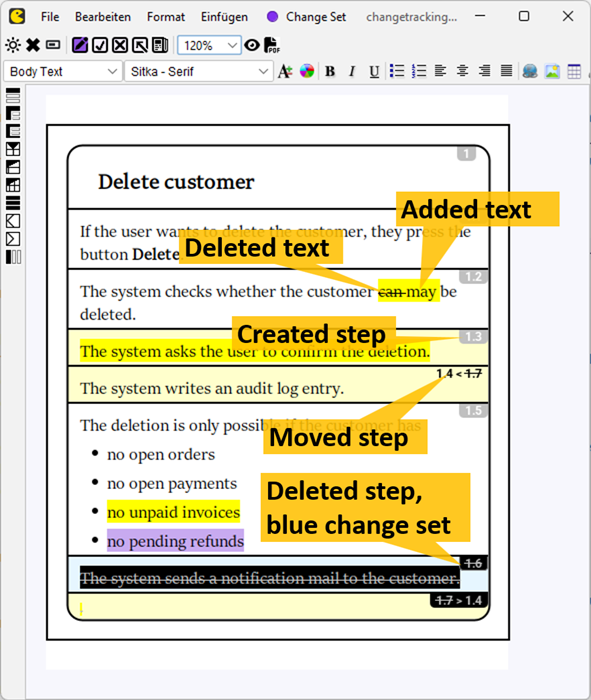

Added text has a background in the changeset color, added steps a pale panel in that color. Deleted text is struck through on a background in the changeset color. A deleted step gets a panel in the changeset color, a black step number tab and light-gray, struck-through text on black.

Moving a step leaves a placeholder behind at its old position: a black-tabbed step with empty content, and a step number label like [line-through]#2# > 5 ("moved from 2 to 5"). At the new position, the step carries the changeset color and the label 5 < [line-through]#2# ("came from 2"). It's all one move, so accepting or rejecting it always takes care of both places.

If a folded step contains changes, its unfold button is displayed in the color of the changeset to which the first hidden change belongs. So even a folded step shows that there is something to look at, and by which changeset.

### Changesets
Sometimes more than one set of changes is in the air: several change requests being considered in parallel within one iteration, or changes of changes in a multi-loop coordination, where each round of feedback should be recognizable on its own. For this, Specman provides _changesets_. Each changeset has its own color, and all of them are displayed at the same time.

There are five changesets, which are predefined and cannot be changed or extended yet: yellow, lilac, blue, orange and pink. The colors were chosen to remain distinguishable for people with most kinds of color vision deficiency.

The current changeset is the one which new changes are assigned to. It is chosen in the _Change Set_ menu of the menu bar, and it is recognizable at any time by the colored dot in the menu title and by the color of the toolbar buttons for change tracking. Accepting, rejecting and merging, as described below, always refer to the current changeset only.

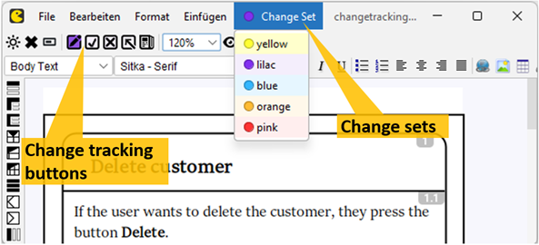

### Accepting and rejecting changes
The toolbar buttons _Accept changes_ and _Reject changes_ accept or reject all changes of the current changeset in the entire diagram, including intro and outro. Changes of other changesets are not touched. There is no way of accepting or rejecting changes selectively yet, e.g. for a single step.

Accepting makes the changes part of the specification: added content loses its marking and deleted content is actually removed. A moved step stays at its new position and the placeholder at the step's original position disappears.

Rejecting does the opposite: added content is removed, deleted content is restored, and moved steps return to their old position.

Both operations are a single undo step.

### Merging changesets
The toolbar button _Merge change sets_ pulls the changes of another changeset into the current one:

Pressing the button opens a list of all changesets except the current one. The changes of the one you choose are recolored into the current changeset, which makes it the target of the merge. This is typically the consolidation step at the end of a multi-loop coordination: the outcome gets merged into a single changeset, which is the basis for development and testing. Merging can be undone.

### Review
Even with only a few changes, they can be hard to find in a large diagram. The toolbar button _Collapse for review_ folds up all structured steps which contain no changes, so that only the parts of the diagram remain open which are worth a reviewer's attention.

image::../src/main/resources/images/review.png[Review Button]

## Meta tags
Since version 1.4, the steps of a specification can be equipped with _meta tags_: small colored tabs which hang at the top edge of a step, to the left of its step number. They hold information about the step which is useful, but doesn't belong to its actual content, e.g.

* who performs the step: the user, the system, an external system,
* the implementation status of the step,
* the requirement or ticket the step originates from,
* an open question to be clarified in the next review.

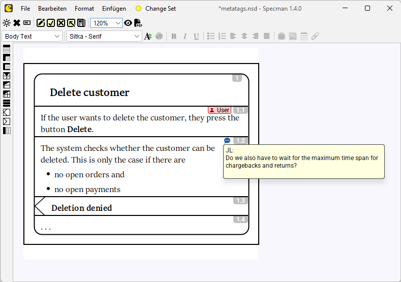

Which kinds of tags exist is entirely up to you. There are basically two terms to understand for tagging:

Meta tag configuration:: Describes a _kind_ of tag: its name, what it looks like (label, icon, colors) and whether its tags can carry a freetext. The configurations are created once per diagram and saved with it. In the following, they are just called _configurations_.

Tag:: A single _occurrence_ of a configuration _at a step_. It looks the way its configuration says, and carries an individual freetext if the configuration allows. A step can have several tags, but only one per configuration.

I.e. configurations are what you set up first, tags are what you then attach to the steps.

### Configuring meta tags
The configurations of a diagram are managed in the dialog which is opened by choosing _Meta Tags..._ from the _File_ menu. Alternatively, you can reach it from a step number's context menu, see below. The dialog lists all configurations of the diagram. Pressing _New..._ creates a configuration, _Edit..._ changes the selected one (a double click on a list entry does the same), and _Delete_ removes it.

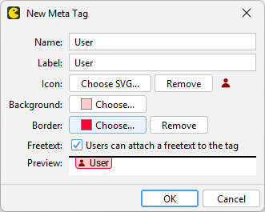

Most of the dialog for creating or editing a configuration is self-explanatory, and the preview shows what the tags will look like. The name is how the tags at steps refer to their configuration. It must be unique in the diagram, may only consist of letters, digits and underscores, and cannot be changed once tags use the configuration. The label is the text displayed in the tags of this configuration, if any. Either a label or an icon must be provided. The icon comes from an SVG file and is embedded in the diagram file, so the original file isn't needed any more. A border is optional and off by default, and the freetext option is on by default.

NOTE: The bottom corners of a tag are rounded. Parts of an icon which reach into these corners are cut off. If your icon has sharp corners at the bottom or fills its entire area, leave a little margin around the graphic in the SVG.

Changes to a configuration take effect immediately in all tags which refer to it. Deleting a configuration also removes all tags which refer to it. If there are any, Specman asks for confirmation first. Creating, changing and deleting a configuration can be undone and redone like any other operation. The configurations are saved with the diagram, i.e. every diagram has its own set of configurations.

### Attaching tags to steps
To attach a tag to a step, right-click the step number and choose the configuration of the tag from the _Tags_ submenu. The menu items show the icon and label of the configurations (or their name if they have no label). Configurations for which the step already has a tag are grayed out, as a step can only have one tag per configuration. The submenu's last entry _Configure..._ opens the dialog for managing the configurations, so a missing configuration can be created without going back to the _File_ menu.

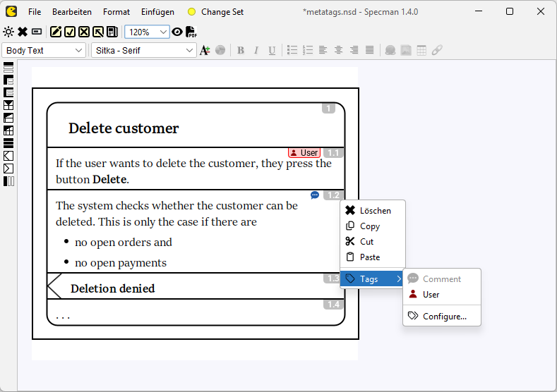

The first tag attached to a step hangs directly to the left of the step number, the next one to the left of that, and so on. If the step has a fold button, it is always located to the left of the last tag. This is deliberate, because the fold button is only visible while the mouse is hovering over its location. If a step is too narrow to show all of its tags, the tags farthest to the left are cut off.

Tags can be attached to every step that has its own step number, with these exceptions:

* Steps marked as deleted do not accept new tags.
* The headings of catch areas are no steps of their own and therefore don't have tags. The steps inside the handling sequence of a catch area do.

Attaching and removing tags is not part of change tracking: it is not marked as a change, and works the same way in change mode and normal mode.

### Working with tags
Each tag has its own context menu, brought up by right-clicking the tag:

* _Edit_ opens the freetext editor. The item is only available if the configuration of the tag allows freetexts.
* _Move left_ and _Move right_ change the order of the tags at the step. The items are only shown if the step has more than one tag, and disabled at the end of the row.
* _Delete_ removes the tag from the step.

The order of tags can also be changed by dragging a tag with the mouse. A vertical line shows where the tag will end up when the mouse button is released.

#### Freetext
If the configuration of a tag allows freetexts, the tag can carry an individual text. When the mouse rests on the tag, the text is displayed as a tooltip. The freetext is plain text: Formatting is not supported, and HTML tags are shown literally.

A single click on the tag, or _Edit_ from its context menu, opens the freetext editor. It looks like a note and appears below the tag, or above it if there is no room below on the screen.

* Clicking anywhere outside of the editor closes it and takes over the text. _Ctrl+Enter_ does the same.
* _Escape_ closes the editor and discards the changes.
* The _Enter_ key inserts a line break.
* The editor window is limited to 12 lines. A longer text is displayed with a scrollbar. The tooltip has no such limit.

Each freetext change can be undone and redone. If a configuration is changed to not allow freetext any more, the texts of its existing tags are neither shown nor saved any longer. If this change is undone, the texts come back.

On PDF export, the freetext of a tag is exported as a comment, which can be read in all common PDF viewers like Acrobat Reader, Chrome or Edge.

Freetexts of tags can be searched and replaced with Specman's search dialog (_Ctrl+F_) after changing _Search in:_ from _Model_ to _Tags_.

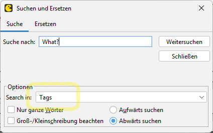

#### Copy & Paste
Tags are kept when steps are moved or copied within a diagram. Copying steps to another diagram only takes their tags along if the target diagram has a configuration of the same name. Configurations are never taken over into the target diagram on pasting. Specman reports the names of the missing configurations in a short notification, so you can create them in the target diagram and paste again. If the target diagram has the configuration but it doesn't allow freetexts there, the tag is pasted without its freetext. The freetext is dropped silently, without a notification.

[#aiassisted]
## AI-assisted specification
Specman and its file format were designed to involve AI agents in the work on specifications. A specification is not only read by people. It is the starting point of everything that follows, and agents can take part at every stage:

* *After the specification:* the text format of a diagram can be read directly by agents, which makes it possible to carry a specification on into the following steps of the work.
* *During the specification:* agents can collaborate while the specification is still being written, e.g. by checking it for completeness, consistency and coverage of requirements.
* *Writing the specification:* agents can also help with creating it, in particular if existing specifications are available as templates. At least one such template is part of every delivery of Specman: a reference model which applies every modeling aspect of the Specman file grammar.

This chapter is about the collaboration during the specification. A Specman diagram is a text file with a pseudocode-like syntax, so an agent can work on a specification while you keep the diagram open in Specman: the agent changes the file, and the changes show up in the window within seconds. You can edit in parallel, and the agent sees what you did. The chapter explains how the pieces fit together.

Two terms are used strictly in this chapter. The _model file_ is the `.nsd` file you open and save. The _working copy_ is the file `.nsd.wrk` next to it. The working copy is the channel between Specman and the agent in an interactive collaborative headless. The agent edits the working copy, rather than the model file.

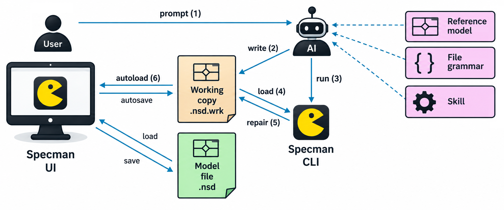

### Setting up
Choose _File_ > _Settings_ and switch on _Auto-load_. Specman then watches the working copy and loads it whenever it changes. Additionally switching on _Auto-save_ (5 seconds is a good choice) makes Specman write your own edits to the working copy, so the agent always works on your latest state.

Specman creates the working copy next to the model file when loading or saving a diagram, as long as auto-load or auto-save is on. A new diagram therefore needs to be saved once before an agent can work on it.

The agent needs to know the file format. The grammar `SpecmanModel_V002.g4` and the reference model `specman-reference-v1.4-model-v2.nsd` are located in the root directory of the installation, next to the launcher. Point your agent to them, and tell it how to work with them, see <<teachingtheagent,Teaching the agent>>.

### A round trip
The numbers refer to the picture above.

* *(1)* You tell the agent what to do with the specification (the prompt). In many cases the prompts refer to step numbers you see on the screen in your running Specman UI, e.g. _"Please suggest checks for weak search criteria after step 3.4."_
* *(2)* The agent writes the changes into the working copy. All changes should be written in a single operation, because Specman may load the file in between two writes.
* *(3)* The agent runs the sanitizer on the working copy, see below. The picture calls it _Specman CLI_, because the sanitizer is one of the command-line operations of Specman.
* *(4), (5)* The sanitizer loads the working copy, repairs what can be repaired and reports what it did. Above all, it reports which steps have been renumbered. The agent needs this to understand your next prompt, because you refer to the numbers you see in the window. If the sanitizer reports an error instead, the agent fixes the file in another edit and runs the sanitizer again.
* *(6)* Specman notices the changed working copy and loads it automatically. The diagram is rebuilt, and Specman now treats it as unsaved.

Your own edits in the window take the opposite way: auto-save writes them into the working copy, so the agent always works on your latest state. Once you are happy with the result, save the diagram (_save_ in the picture). This is the only thing which writes the model file. Loading a diagram (_load_) is the moment where Specman creates the working copy.

Loading replaces the entire diagram, including the undo history. Undo does not reach back behind the agent's changes. Your edits that have not yet been written to the working copy yet are replaced without asking, which is why auto-save is recommended.

### The sanitizer
The sanitizer checks a file and repairs what can be repaired automatically. It is a command-line operation of Specman: it runs without a window and without a running Specman, and usually only takes a second to check and repair a file. There are two reasons for the sanitizer to exist:

* An AI agent is not a deterministic generator, so it may produce a file that does not conform to the grammar. The sanitizer checks the file syntax and important consistency rules, and gives the agent instant feedback to help it make corrections.
* Some jobs in maintaining a specification file are complicated and error-prone for an AI agent, but trivial for Specman CLI. The most important one is the consistent renumbering of steps, together with the step references in the texts, whenever the structure of the diagram has changed. The sanitizer takes care of that, so the agent doesn't have to. Its output tells the agent which steps got which new numbers. So the agent can update its context for the next prompt without reading the entire specification again.

Specman comes with a console launcher for such operations, called _Specman CLI_ here. The launcher depends on how Specman was installed:

* With the Windows installer, it is `specman-cli.exe` in the installation directory. Additionally, the installer puts the command `specman` on the PATH, which forwards to it. So `specman --sanitize <file>` works in every newly opened terminal.
* With the portable bundle on Windows, it is `specman-cli.bat`: `specman-cli.bat --sanitize <file>`. `specman.bat` is not suitable, because it starts Specman without a console and passes no exit code back.
* With the portable bundle on Linux, `specman.sh --sanitize <file>` does it.

There are three possible results:

* `OK`: the file is fine and untouched.
* `SANITIZED` and a list of what has been done: the sanitizer changed the file in place. It renumbers the steps, adjusts step references in the texts accordingly, and regenerates the plain text renditions. The list names the old and the new number of every renumbered step, with its type and the beginning of its text, e.g. `1.2 -> 1.3 (simple) "The system checks whether ..."`. An agent may therefore insert a step with any temporary number such as 3.2.4.2b, and does not have to renumber anything. The list tells the agent which number the new step got.
* `ERROR`, the line and column of the problem, and exit code 1: the file cannot be read or is inconsistent, e.g. because of a syntax error, duplicate step IDs, an invalid meta tag or a step reference to a step which doesn't exist. Specman prints this to the error stream, so an agent must read stderr as well.

If the sanitizer changed the file, Specman loads it a second time, and the diagram may update twice.

### Rules of the game
* The last writer wins. There is no merging. While the agent is working, you had better not type in the diagram, otherwise your text is replaced when the agent's changes arrive.
* Auto-save does not overwrite a working copy which was changed from outside and has not been loaded yet. That's what makes it safe if the agent writes at the very moment auto-save is due.
* If the agent leaves a file that cannot be loaded, Specman shows a notification and keeps the diagram as it is. The agent has to fix the file right away. If you change something in the diagram in the meantime, the next auto-save replaces the agent's file with the diagram's state.
* Closing Specman asks whether to save, because the loaded working copy counts as unsaved changes. After closing normally, the working copy is deleted. After a crash it stays, and Specman offers to restore from it the next time the diagram is opened.
* The model file is not watched. If an agent edits it directly, Specman doesn't notice, and the next save overwrites it.

[#teachingtheagent]
### Teaching the agent: what belongs in a skill
An agent does not know Specman, so it has to be told what this chapter told you. Specman deliberately doesn't deliver a ready-made instruction file such as a skill: these age quickly with every new agent generation, and they need to be tailored to your project anyway. Therefore, this section only lists what belongs in a skill. Put it into whatever your agent loads on its own, e.g. a separate skill file, a `CLAUDE.md` or an `AGENTS.md`, so that it applies whenever the agent is asked to work on a Specman diagram.

Some things only you know and are part of the instructions as well: the exact command to start Specman CLI on your machine (see above), the language of your specifications, and the terminology and the level of detail your specifications follow. It is usually reasonable to provide a class model along with the Specman modells which provides the vocabulary.

#### The file format
Tell the agent where the grammar and the reference model are, and that it has to read the header of the grammar first. The header lists the conventions which matter for an agent. The most important ones:

* The first line, an envelope in JSON, must stay intact.
* Every step has a unique ID of 8 lower-case hexadecimal characters. New steps get a new one.
* Step numbers may be made up, the sanitizer fixes them. Existing numbers should not be "corrected" by the agent.
* Step IDs are stable, step numbers are not: they change whenever steps are inserted or moved. An agent should therefore identify a step by its ID when editing the file, even though your prompts refer to step _numbers_.
* The text of a step is HTML in backticks and must not contain backticks itself.
* Plain text renditions (`plain=`) are generated and the agent doesn't have to spent time with deriving them from the HTML content.
* Image blocks consist of Base64 data. The agent leaves them alone and skips them when reading the file, because they are large and of no use to it.

The reference model contains an example of everything the format can express and is the best source for the agent to copy patterns from.

#### The workflow
Spell out the procedure of the round trip as well, because an agent doesn't find it out by itself. The instructions should make sure that the agent:

* edits the working copy, not the model file, and never deletes the working copy.
* reads the working copy once at the beginning of a session. Your prompts refer to the step numbers shown in the window, and the agent finds the steps in the file by those numbers.
* does nothing without a request, because you may be typing in the diagram at the same moment.
* writes all changes of a prompt in a single edit operation.
* runs the sanitizer on the working copy right after each edit, and reads both its output and the error stream.
* fixes the file right away in one edit and runs the sanitizer again, if the sanitizer reports `ERROR`.
* takes the list of renumbered steps as its new picture of the diagram after `SANITIZED`, instead of reading the whole file again. Your next prompt refers to these numbers.
* inserts new steps with a made-up number like `3.2.4.2b`, and never renumbers existing steps.
* leaves the file alone after the sanitizer is through, until your next prompt.
* records edits as change marks only when you ask for it, and checks them against the rules in the grammar, see <<_change_mode_and_agents,Change mode and agents>>.

TIP: For small edits like rewording a step, switch off the extended thinking mode of the agent if it has one. The answer comes much faster, and so do the changes in your window.

### Change mode and agents
The format can express change marks, so an agent can record its edits as changes, just like you would in change mode, see <<changetracking,Change Tracking>>. It often works, but it requires some care: the agent has to write the marks itself, and the sanitizer doesn't check them. If the result looks odd, have a look at the marks in the diagram and ask the agent to correct them, before accepting or rejecting anything.

