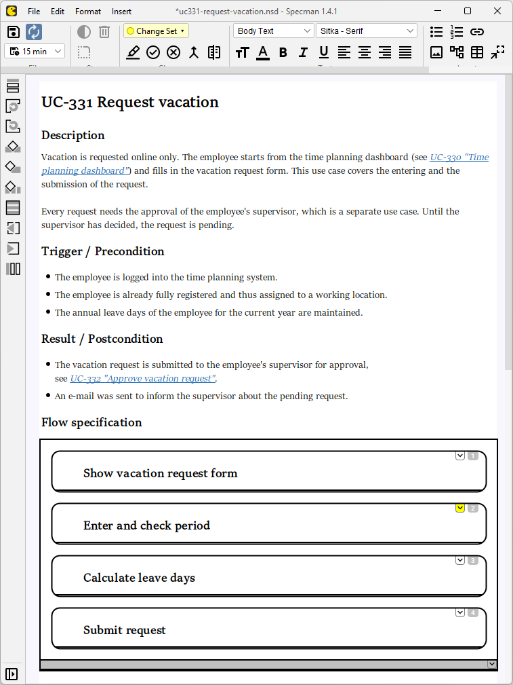
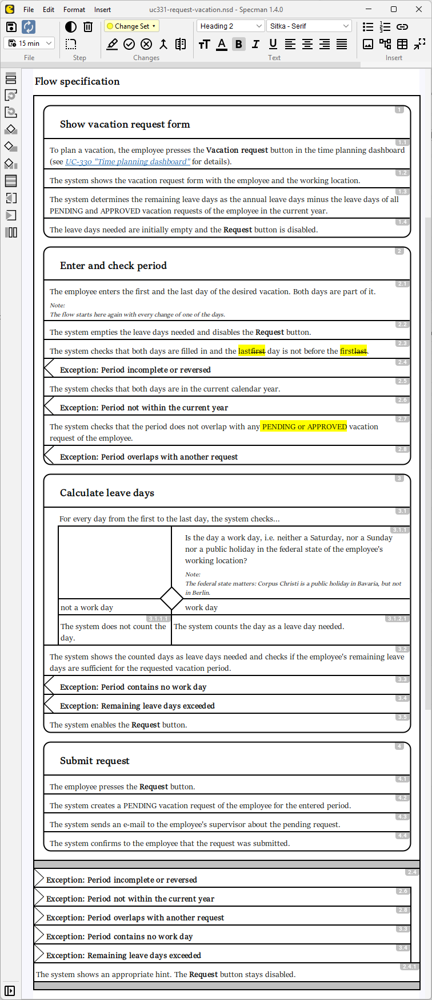
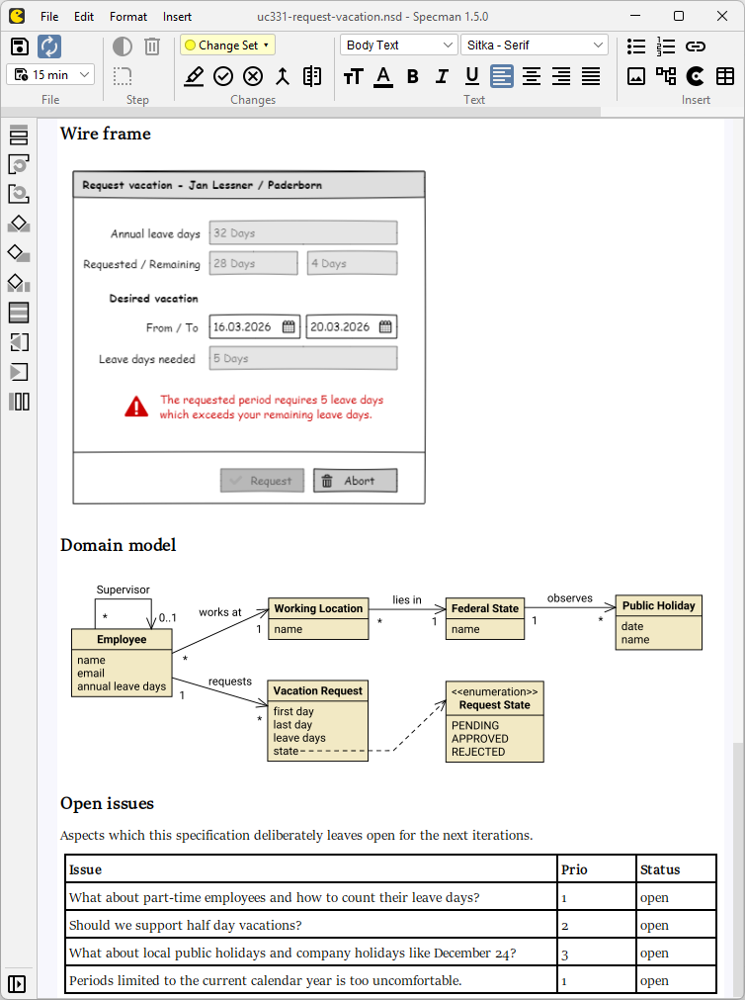

// Generated from howto/template-readme.adoc and doc/specman-manual.adoc by 'mvn package' - do not edit
# Specman Diagram Editor

Specman is a WYSIWYG editor for actogramms, which are strongly inspired by Nassi-Shneiderman diagrams but incorporate graphical elements from UML activity diagrams. Specman is designed for the specification of procedural workflows in software systems, and grew out of more than 15 years of experience in software engineering based on standard tools like Microsoft Word, Confluence and UML.

Microsoft Word is an excellent word processor with change tracking (a crucial aspect for iterative / agile development), but control structures like loops and branches are difficult to visualize. UML activity diagrams, on the other hand, are very good at visualizing control structures, but change tracking and diagram layout stability in iterative development are poor. Specman combines features of these tools in a way that has proven particularly useful for efficient, iterative software development.

Efficiency today also means AI assistance in every phase of software engineering. Specman is built for it: machine-readable text format with defined grammar, command line interface, and live collaboration between agent and user.

## Hello Specman
Specman is a small Java 2D / Swing application packaged as an executable JAR file using Maven. To run Specman, you need a Java Runtime Environment (JRE) version 21 or higher installed. The main class is specman.Specman, and the delivery package includes launcher scripts for Windows (`specman.bat`) and Linux (`specman.sh`) that check the Java installation and locate the jar before starting the application. Windows users may alternatively use the Windows installer, which ships with its own Java runtime, so no JRE needs to be installed. Opening the file link:doc/uc331-request-vacation.nsd[uc331-request-vacation.nsd] in Specman displays the use case with all steps of its flow collapsed:

The use case is taken from a typical enterprise scenario: employees of a company should be able to submit vacation requests online via a time planning portal. A short description and pre- and postconditions are followed by a flow specification in 4 steps. It looks similar to an activity diagram, only without the connecting arrows, but with automatic numbering of the steps instead. If there were nothing more to say about the vacation request procedure besides these trivialities, Specman wouldn't be needed. However, it should be intuitively clear that there are also various business requirements for the details of the individual steps.

So where are these details?

This is where it gets interesting, because each of the steps is sub-structured and can be expanded using the  button. If you do this successively for all steps (or for the whole diagram using the  button in the ribbon bar), the diagram looks like this:

While the diamond for a decision node is known from activity and BPMN diagrams, the rest of the layout follows the concepts of Nassi-Shneiderman diagrams, a.k.a. "structogramms". It combines aspects that are particularly well suited for specifications:

- The layout always stays intact when the structure changes: when adding / removing / reordering steps, as well as when expanding and collapsing substructures. We work iteratively, and the diagrams live along with the code and change permanently. Layout instability as in activity diagrams is a shortcoming for specification work.

- Important control structures like loops, branches and error aborts are graphically recognizable.

- The format tolerates arbitrary nesting of steps and extensive text content. It does not limit the work if business requirements need very precise alignment at deep levels of detail.

For a specification to become _really_ understandable, its wording must be based on a clearly defined vocabulary of the business domain. Simple domain class modeling can be done directly in Specman via the PlantUML integration. The appendix of the vacation request model contains a wire frame for a dialog - embedded here as a screenshot - and the domain model with the terms used such as "Vacation Request" and "Working Location" and their relationships.

This combination is the foundation for implementing the requested functionality without misinterpretation of business requirements. A specification for software is like the construction plan for a building, like a circuit diagram for an electronic device, or like a score for an orchestra. A clear plan before the craftsmen start.

Specman stands for up-front design for every iteration or sprint rather than "design a little, code a little", which is a widespread antipattern. Check out link:https://clean-code-developer.com/[clean-code-developer.com] to see why it's _anti_. Writing code directly from the business requirements has a high risk of ending up in spaghetti code which does not even match the (partly unspoken) requirements. Software specification makes everything visible and touchable and makes it possible to discuss and clarify open issues before the first line of code is written. Developers have a much better chance to work "in flow", based on clear specifications, thus working much more efficiently and with less stress. The result is a better product, delivered faster and at lower cost for both AI-assisted and human-only development.

Have a look at the open issues at the very bottom of the vacation request example. They have been left open intentionally to illustrate the point: it is much cheaper to talk about them _before_ starting the implementation than to find them out while coding. No big problem in one-shot coding, but a nightmare in iterative development where requirements are constantly changing.

### AI-ready file format
Since version 1.3, the diagram files have a pseudocode-like format which makes them machine-readable e.g. to feed code generators or AI agent based programming pipelines. The file structure follows an EBNF grammar defined in SpecmanModel_V002.g4, which is part of the delivery. It is explicitly designed to also integrate AI support in the process of creating specifications. Using Specman's autoload mode and its headless CLI makes it possible to set up a collaborative environment where the user is working with the WYSIWYG UI while an AI agent is assisting in the background. Specifications are supposed to be designed as both human-readable and technically exact, using a natural but precise language according to basic clean code development principles and the central ideas of Domain-Driven Design. The result is a document with structure and textual content which is perfectly understandable for AI agents.

### PDF export
Specman provides a high-quality PDF export, so that the diagrams can be shared easily with everyone involved in the software engineering process. Reviewers only need a standard tool like Adobe's Acrobat Reader to open and comment on the exported diagrams. See link:doc/uc331-request-vacation.pdf[uc331-request-vacation.pdf] for an example of a PDF export of the "Request vacation" use case.

### Change tracking
The yellow highlighting in the expanded screenshot above indicates changes which were made in change mode. Similar to Microsoft Word, e.g. deleting text in change mode does not actually remove the text; instead, it is displayed as struck through with a yellow background as if someone had marked the section with a text marker. Changes in a model are therefore immediately recognizable by everyone. This is a crucial aspect in iterative development where specifications evolve over time.

Folding up a structured step which includes any change marks will cause the unfold-button beside the step number to be displayed in the highlight color of the hidden changes. I.e. even if details are hidden, it is still visible that there are changes in the folded up section, see step 2 in the first screenshot.

Since version 1.2.1, Specman supports multiple change sets, which is of interest e.g. if there are multiple change requests to be considered in parallel within a single development iteration.

### Real world use case specifications
To get an idea of what real-world specifications look like in Specman, see the link:doc/usecase-birdsview.png[bird's view] on a mid-size system usecase specification from ongoing project development.

## Further information

### Manual
The complete manual is available at link:doc/specman-manual.adoc[Specman Manual]. The online manual and the release history are available on the link:https://j-specman.github.io/[Specman website].

### Building
For maintainers, building and publishing a release is described in link:howto/howto-release.adoc[How-to: Release erstellen und auf GitHub veröffentlichen].

Project setup and creating of the Specman Windows installer is described in link:howto/howto-windows-installer.adoc[How-to: Specman Windows Installer].

Maintainers should take the link:specifications/architecture/specman-architecture.adoc[Specman Architecture] documentation into account when changing the code.
